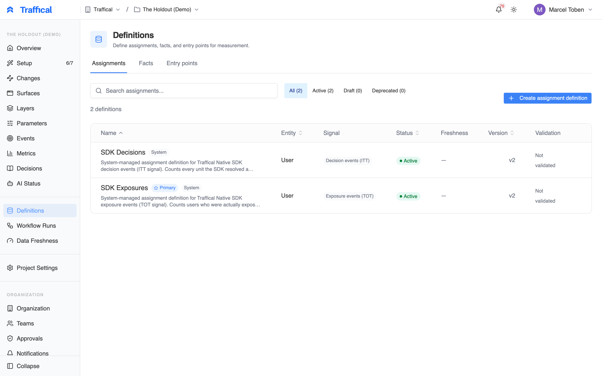
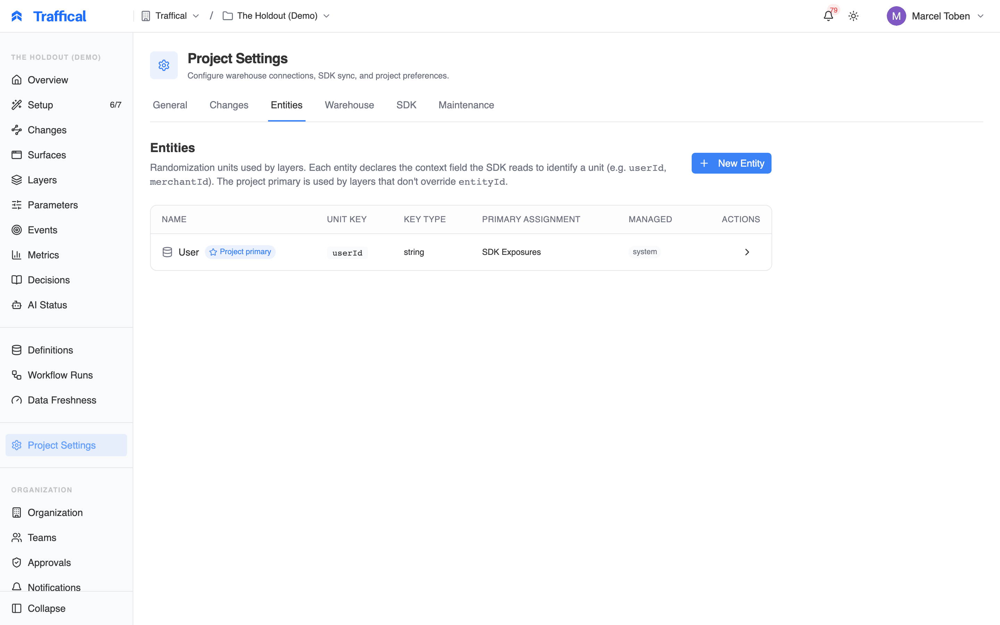
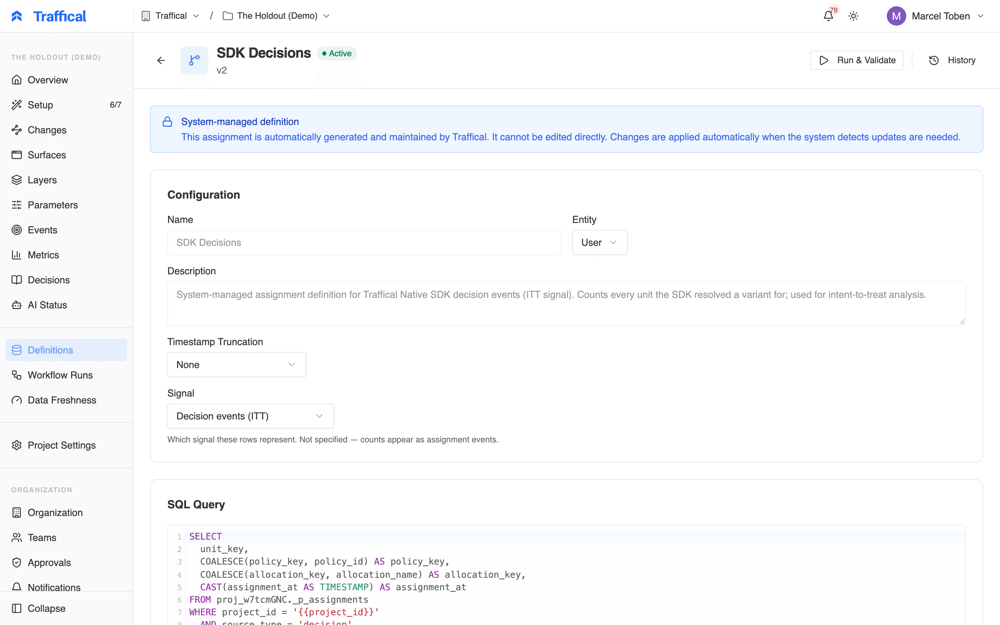
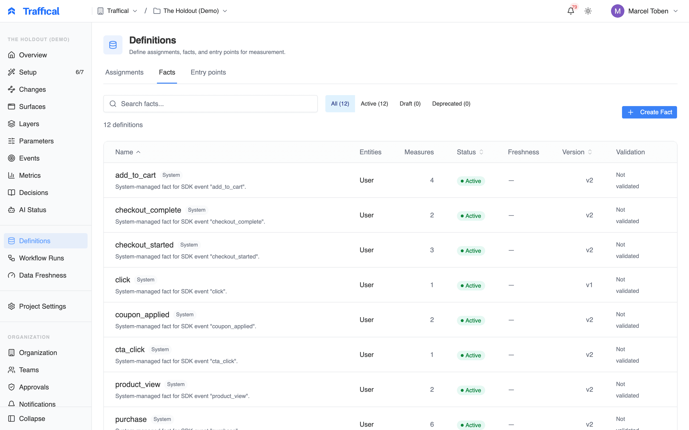
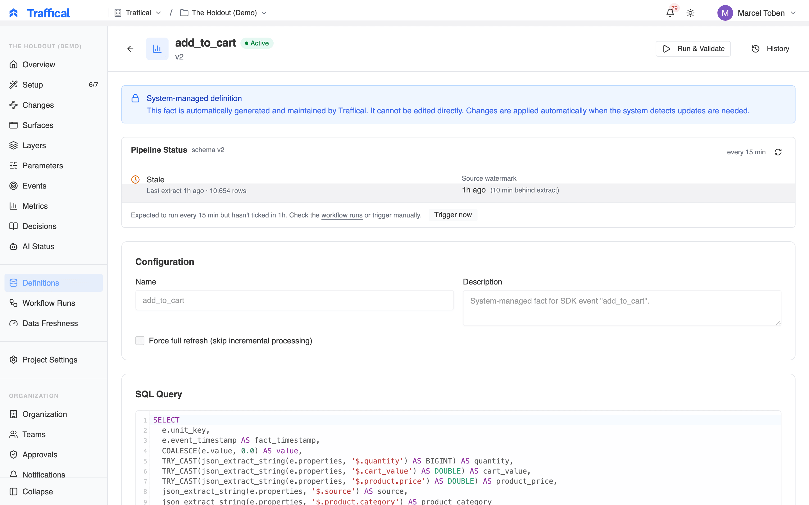
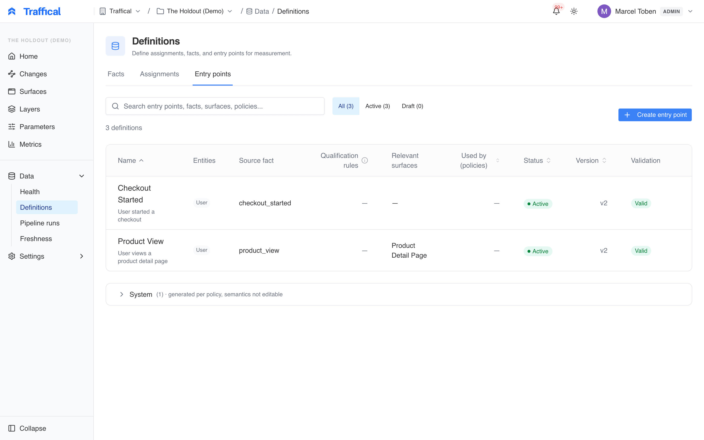

The **Definitions** section is where warehouse-native experimentation lives. You won't visit this page if you're using Traffical-native events only — but if any of your metrics come from your own data warehouse, this is the canvas.

The section has four sub-pages: **Entities**, **Assignments**, **Facts**, and **Entry points** — reusable milestones with [qualification rules](/concepts/terminology#entry-points-and-qualification) that determine when a unit qualifies for measurement. See [warehouse-native](/concepts/warehouse-native) for the conceptual model.

<Frame caption="Definitions overview">
  
</Frame>

## Entities

An **entity** is the unit of randomization — User, Company, Device. Each entity has a `keyType` that matches the project's unit key.

<Frame caption="Entities list">
  
</Frame>

Most projects have one entity (`user` keyed on `userId`). B2B / multi-tenant projects often have two (`user` and `company`). Defining an entity is a one-line action — name, key type — and is rarely revisited.

## Assignments

An **assignment definition** is the SQL that produces the unit → [allocation](/concepts/terminology#allocations-and-traffic-splits) mapping for warehouse-native measurement.

<Frame caption="Assignments list">
  
</Frame>

Each row in the list:

- Name
- Entity it's keyed on
- Source — SQL (warehouse) or SDK-managed (auto-generated from the SDK's [decision and exposure events](/concepts/terminology#assignment-events))
- Signal — the [analysis signal](/concepts/terminology#analysis-signal) the rows carry: decision, exposure, or mixed
- Last run timestamp and status

Most projects don't need any assignment definitions — SDK-managed assignments are created automatically when the SDK emits decision and exposure events. You only need an explicit assignment definition when assignments come from somewhere other than a Traffical SDK (a migration from another tool, a custom assignment service, a warehouse table maintained outside Traffical).

### Creating an assignment definition

<Frame caption="Assignment editor">
  
</Frame>

In the editor:

1. **Name** the definition
2. **Pick the entity** (user, company)
3. **Pick the warehouse connection**
4. **Write the SQL.** It must return columns: the entity key (e.g. `user_id`), `assigned_at`, `policy_key`, `allocation_key`. Use `{{start_date}}` and `{{end_date}}` template variables for time scoping.
5. **Set the Signal** — declare whether the rows are decision events (intent-to-treat) or exposure events (treatment-on-the-treated). If the source holds both kinds, map a `source_type` column and declare the signal as mixed.
6. **Preview** — the dashboard runs a small `LIMIT 10` sample to verify the columns and types.

The `policy_key` column values must match `key` fields on Traffical policies. The `allocation_key` values must match allocation `key` fields. This is how the pipeline knows which Traffical policy the warehouse data corresponds to.

## Facts

A **fact definition** is the SQL that produces outcome events.

<Frame caption="Facts list">
  
</Frame>

Each fact can power many metrics — an `orders` fact can be aggregated into "revenue per user" (sum), "conversion rate" (proportion with any order), and "order count" (count). The fact is the data; the metric defines the aggregation.

### Creating a fact definition

<Frame caption="Fact editor">
  
</Frame>

In the editor:

1. **Name** the definition
2. **Pick the entity** (user, company — what each row is associated with)
3. **Pick the warehouse connection**
4. **Write the SQL.** It must return the entity key, an `event_time`, and any value columns you want to aggregate (e.g. `order_total`).
5. **Preview** — sample query against the warehouse to verify columns and types.

A fact can be joined to multiple entities (a row tied to both `user_id` and `company_id`) — useful for SaaS metrics measured at the user level but randomized at the company level.

## Entry points

An **entry point** is a reusable milestone that decides when a unit starts counting for measurement: reaching checkout, opening a product page, finishing onboarding. It's built on a fact, with optional rules that pick which rows of the fact count. Once a policy uses it, the analysis keeps only the units that reached the milestone after their first assignment and measures each of them from that moment. [Policy settings](/dashboard/policy-settings#entry-point) explains the effect on results, and [entry points and qualification](/concepts/terminology#entry-points-and-qualification) defines the terms.

<Frame caption="Entry points list">
  
</Frame>

The list shows each entry point's entities, source fact, number of qualification rules, relevant surfaces, the policies using it, its status (**Draft**, **Active** or **Deprecated**), version and validation result. A **System** section at the bottom holds entry points Traffical generates per policy, such as SDK exposure; you can't edit their rules.

### Creating an entry point

1. Click **Create entry point**.
2. Give it a **Name** (for example "Checkout started") and an optional **Description**.
3. Pick the **Source fact**. Only active facts that map at least one entity are offered. **Supported entities** shows which entities the entry point can be used with: every entity the fact maps.
4. Click **Save & Continue to Editor**. The entry point is saved as a draft.

In the editor:

- **Qualification rules** pick which rows of the fact count. Without rules, every row qualifies. Choose **All conditions must match** or **Any condition may match**, then **Add condition** or **Add group** for nested conditions. Each condition compares a column of the fact with a value: equals, does not equal, is one of, is not one of, is greater than, is at least, is less than, is at most, is present, is missing. The operators offered depend on the column's type, and a row with no value never matches a comparison. A summary under the rules says in words which rows qualify.
- **Preview** counts, over the last 7, 14 or 28 days, how many rows match the rules and how many distinct units they cover, with a sample of units and their earliest qualifying time. It runs only when you click **Run preview**. It doesn't look at assignments, so it shows what the rules select, not how many test units will qualify.
- **Planning** shows how many qualified units the entry point produces per day and week, computed nightly from history. Change planning uses this rate to size experiments that measure from the entry point.
- **Relevant surfaces** maps the milestone to the [surfaces](/concepts/surfaces) it belongs to. It helps the entry point show up as a candidate for changes on those surfaces and never changes what qualifies.
- **Run & Validate** checks the source fact, the rule columns and their types. **Activate** makes a draft available to policies and changes.

The editor repeats the causal warning: use a milestone the change can't influence, or the qualified units differ between allocations.

### Using an entry point

A [change's](/dashboard/changes) measurement plan can use any active entry point; the policy that runs the experiment inherits it. On a standalone policy, choose one under **Settings → Analysis → Entry point**: pick a fact to qualify on every row of it, or use **Create with rules…** to create an entry point with rules from the policy. See [Policy settings](/dashboard/policy-settings#entry-point).

**Used by** on the editor lists the policies and approved measurement plans that use the entry point.

### Changing or retiring an entry point

Name, description and surfaces can change at any time without affecting results. Changing the rules, the source fact or the supported entities of an active entry point that running or paused policies, or approved plans, depend on asks you to confirm and lists those dependents. The change applies when you save: the next analysis run recomputes qualification for those policies over their whole run. Each such change raises the version, and policies show the version they're measured with. You can't remove an entity that a dependent policy uses.

**Deprecate** retires an entry point so it can't be chosen again, and **Reactivate** brings it back. Deprecation is refused while a running or paused policy, or an approved measurement plan, still uses it. Only drafts that no policy references can be deleted.

## Validation and previews

When you save a definition, the dashboard runs a small query against your warehouse to:

- Verify the connection works
- Confirm the columns exist with the expected types
- Show a sample of the data so you can sanity-check

Validation errors surface immediately. If the preview looks wrong, fix the SQL before saving.

## Next steps

<CardGroup cols={2}>
  <Card title="Warehouse-native" icon="database" href="/concepts/warehouse-native">
    The conceptual model.
  </Card>
  <Card title="Connectors" icon="plug" href="/connectors/overview">
    Per-warehouse setup details.
  </Card>
  <Card title="Metrics" icon="chart-line" href="/dashboard/metrics">
    Turning facts into measurable metrics.
  </Card>
  <Card title="Pipeline" icon="forward" href="/dashboard/pipeline">
    Watching the SQL run.
  </Card>
</CardGroup>
