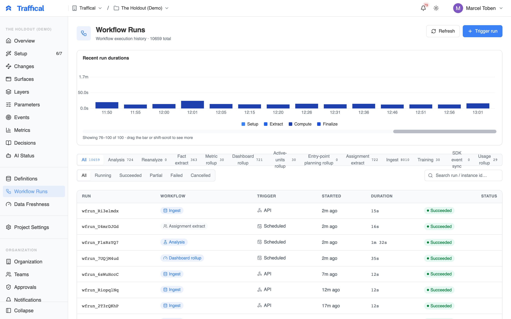
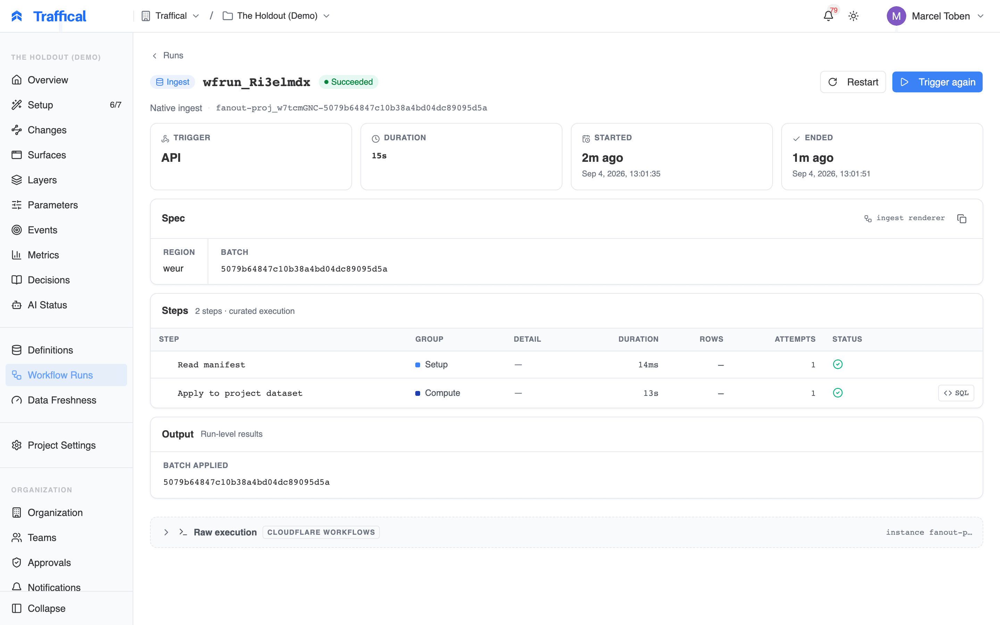
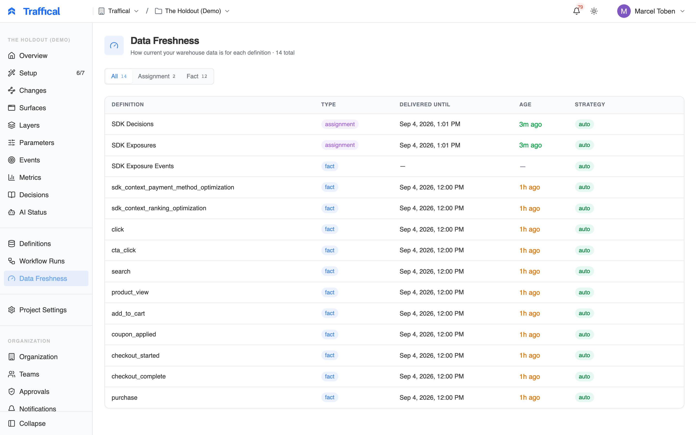
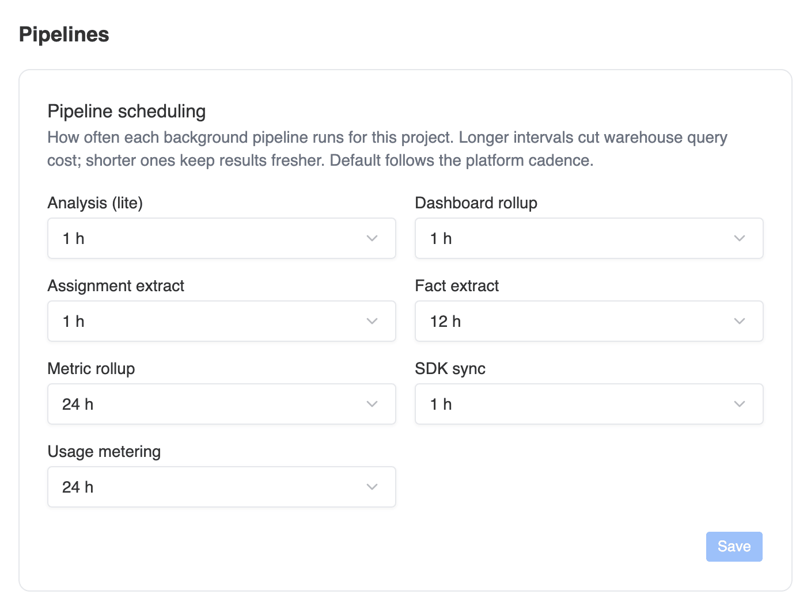

The **Pipeline** section of the sidebar is the operational view of metric computation. On a schedule, Traffical runs SQL against your warehouse — extracting assignments and facts, computing metric results, rolling up dashboards, and evaluating policy health. Use these pages to verify the pipeline is running, spot failures, and see how fresh your numbers are.

The section has three pages: **Definitions** (where the SQL is authored — see [Definitions](/dashboard/definitions)), **Workflow Runs**, and **Data Freshness**. This page covers the last two.

If your project has no active definitions or running policies, these pages are mostly empty — there's nothing to compute yet.

## What runs

Every execution appears as a **workflow run** with a type:

| Type | What it does |
|------|-------------|
| **Analysis** | Computes configured metrics across policies for an analysis window — the run that produces measured results and policy health |
| **Reanalyze** | Recomputes metrics from a prior run with new settings |
| **Assignment extract** | Extracts fresh assignment data — the shared input that analysis and dashboard rollups read |
| **Fact extract** | Extracts a fact definition's SQL into persistent fact-event storage |
| **Metric rollup** | Builds per-metric daily/hourly/lifetime time series for dashboards |
| **Dashboard rollup** | Pre-computes the project dashboard and event explorer |
| **Entry-point planning rollup** | Caches [qualified units](/concepts/terminology#entry-points-and-qualification) per day, per entry point — the planning volume behind qualification-aware sizing |
| **Ingest** | Loads warehouse facts and metric aggregates |
| **Training** | Trains an adaptive-optimization model |
| **SDK event sync** | Syncs SDK events into your warehouse (when [enabled](/dashboard/settings#sdk-configuration)) |
| **Usage rollup** | Meters monthly tracked units for [billing](/dashboard/usage-and-billing) |

## Workflow Runs

The **Workflow Runs** page lists recent executions, newest first, with a duration chart across the top. Filter by type or status, or search by run id.

<Frame caption="Workflow Runs page">
  
</Frame>

Each row shows the run id, workflow type, trigger (scheduled, manual, API, or restart), start time, duration, and status:

- `queued` / `running` — in progress; running rows are highlighted (click **Refresh** to update the list — the run detail page updates live)
- `succeeded` — everything completed
- `partial` — some of the run's work succeeded and some failed; the failures don't block the rest
- `failed` — the run errored
- `cancelled` / `terminated` — stopped before completing

A definition that keeps failing doesn't stall the whole pipeline — other definitions keep computing, and the run lands as `partial`.

## Run detail

Click a run to drill in.

<Frame caption="Run detail">
  
</Frame>

The header shows trigger, duration, and start/end times. Below it:

- **Spec** — what the run was asked to do, with links to the policies, metrics, and definitions involved
- **Steps** — the execution broken into setup, extract, compute, and finalize steps, each with duration, rows processed, attempt count, and status. Sub-steps expand inline; failed steps expand automatically with their error.
- **Output** — run-level results, again linked to the entities they touched

Steps that executed SQL have a **viewer**: click the step's SQL icon to open the rendered query (template variables already substituted), formatted and copyable. Paste it into your warehouse's own console to reproduce a failure or check what was scanned — the fastest way to debug a broken definition.

While a run is live, the page polls every few seconds, so you can watch steps complete.

### Restart, terminate, trigger again

From the run detail page:

- **Terminate** stops a running run. In-flight work is abandoned and the run is marked `terminated`.
- **Restart** re-runs a finished run from a step you choose — useful when a late step failed and the earlier extraction was fine.
- **Trigger again** opens the trigger dialog pre-filled with the same workflow type.

## Manual runs

Click **Trigger run** on the Workflow Runs page to start a run by hand. Pick a workflow type; each exposes a small set of options — for example, an analysis run can be **lite** (headline metrics) or **full** (all policies and metrics), and analysis and metric rollup offer a **Force full rebuild** toggle that drops persisted state and recomputes history. SDK sync offers a **Full resync** toggle instead: it drops the synced tables and re-reads a short lookback rather than all history. Full rebuilds are slow; normal runs are incremental.

Manual runs are useful for:

- Re-running after fixing a broken definition
- Pulling in late-arriving data after a backfill
- Verifying a freshly saved definition works against real data

Manual runs don't disturb the regular cadence — the next scheduled run proceeds as usual.

## Data Freshness

The **Data Freshness** page shows, per assignment and fact definition, how far its source data has landed and whether that is on schedule.

<Frame caption="Data Freshness page">
  
</Frame>

| Column | What it shows |
|--------|---------------|
| **Data through** | The newest row of the source that has reached Traffical. |
| **Lag** | How old the last complete period is, coloured against the definition's delivery: green on schedule, amber when a delivery is overdue, red when the tolerated deliveries were missed. Hover for when the next delivery is expected. |
| **Last run** | When an analysis run last processed the definition. |
| **Delivery** | How the source is expected to land (see below). |
| **Strategy** | **auto**: runs advance the mark. **manual**: you set it, using the pencil. |

Definitions that no running policy reads show **not in use** instead of a lag, because nothing advances them. Draft and deprecated definitions are hidden unless you tick **Show draft and deprecated**. A new definition shows no data until its first run.

### Delivery

Each definition either inherits the project's delivery timing (**Project Settings → Policy health**) or has its own. Set it with the pencil in the **Delivery** column, or from the definition's page.

- **Streaming**: rows land within minutes. Streaming sources are not graded for lag and never hold results back.
- **Batch**: a job loads one period at a time. Choose the cadence (hourly to daily), how long after a period ends its batch usually lands, how many missed deliveries to tolerate, and how far rows may run past the period end (a daily batch that includes a few rows from just after midnight).

Delivery decides two things. Results are computed through the last period every batch source of a policy has delivered, and a source that misses its expected delivery is flagged by the **Source delivery** check in [Policy health](/dashboard/policy-health). A daily table that usually lands by 09:00 UTC for the previous day, for example, is a daily batch landing 9 hours after the day.

If [SDK event sync](/dashboard/settings#sdk-configuration) is enabled for your warehouse, a sources card at the top shows sync health — every definition reading from the synced tables can only be as fresh as the sync itself.

### When numbers lag

If a metric looks stale on the [Metrics](/dashboard/metrics) page or a policy's [measurement progress](/statistics/measurement-progress) has stopped advancing:

1. Check **Data Freshness**: is the relevant definition's **Data through** moving, and is its **Lag** within its delivery? A table that is a day behind the others holds every policy that reads it at the older date.
2. If not, open **Workflow Runs** filtered to `failed`/`partial` and look at the failing step's error and rendered SQL.
3. Common causes: warehouse credential rotated, table renamed in a migration, column changed type.

Pipeline failures can also notify you directly — see [Notifications](/dashboard/notifications). For a broader symptom-by-symptom guide, see [Troubleshooting](/reference/troubleshooting).

## Scheduling

Each workflow kind has a default cadence:

| Workflow | Default | Override range |
|----------|---------|----------------|
| Analysis | Auto — every 5 minutes for projects with adaptive policies, every 15 minutes for A/B-only projects | 5 min – 1 h |
| Analysis (full) | Every 2 h | 2 h – 24 h, with a start time |
| Dashboard rollup | 5 min | 5 min – 1 h |
| Assignment extract | 5 min | 5 min – 1 h |
| Fact extract | 15 min | 15 min – 12 h |
| Metric rollup | 1 h | 1 h – 24 h |
| SDK sync | 5 min | 5 min – 1 h |
| Usage metering | 6 h | 1 h – 48 h |

Adaptive policies get the faster analysis lane by default because the optimizer acts on the results; A/B results only need to be as fresh as your reading of them.

**Analysis** keeps assignments and policy health current. **Analysis (full)** recomputes metric results. When your data arrives in daily batches, most full runs in a day recompute the same numbers, so set **Analysis (full)** to every 24 hours with a start time after your batches usually land. If a batch arrives after that time, an extra full run starts once it has landed, at most once an hour.

Override any cadence in **Settings → Pipeline scheduling** ([Settings](/dashboard/settings)). Longer intervals cut warehouse cost; shorter intervals keep dashboards fresher. One guard applies: the assignment extract feeds analysis and dashboard rollups, so it can't be scheduled less often than either of them.

<Frame caption="Pipeline scheduling in Settings">
  
</Frame>

Scheduled runs only fire when **Automatic pipeline runs** is enabled on the warehouse connection (**Settings → Warehouse**). Manual triggers work either way.

<Note>
Cadence is the main cost lever, but expensive SQL compounds with every run. If a definition is costly, open a recent run's rendered SQL and check that it filters on your table's partitioned or clustered time column — a full-table scan every 15 minutes adds up. See [Connectors](/connectors/overview) for per-warehouse tuning.
</Note>

## Next steps

<CardGroup cols={2}>
  <Card title="Definitions" icon="database" href="/dashboard/definitions">
    Where the SQL is authored.
  </Card>
  <Card title="Metrics" icon="chart-line" href="/dashboard/metrics">
    What the pipeline ultimately produces.
  </Card>
  <Card title="Settings" icon="settings" href="/dashboard/settings">
    Pipeline scheduling and warehouse connection.
  </Card>
  <Card title="Troubleshooting" icon="wrench" href="/reference/troubleshooting">
    When something looks wrong.
  </Card>
</CardGroup>
