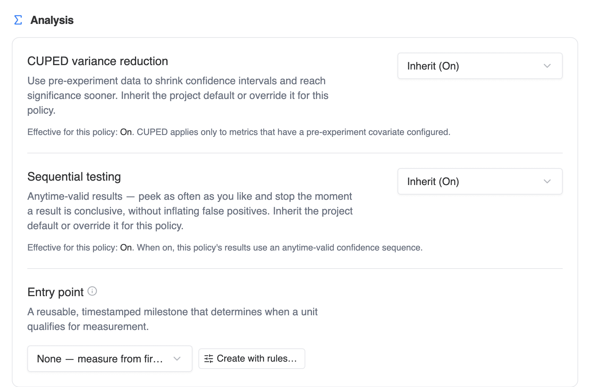
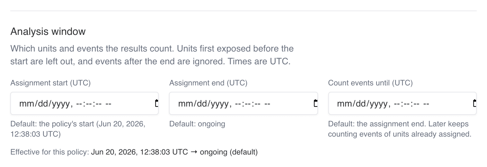

Every policy has a **Settings** tab. It holds what you set once and rarely touch: the key your data is joined on, how the results are analysed, and which parts of the policy may change while it runs. For the rest of the policy page, see [Layers & policies](/dashboard/layers-and-policies).

<Frame caption="Policy settings: analysis">
  
</Frame>

## Policy key

The policy key is the stable identifier in SDK events and in your warehouse `policyKey` column mapping. Copy it from here when you map columns or query results yourself.

## Analysis

The **Analysis** section changes how results are computed. None of it moves traffic, so you can change it on a running policy.

### CUPED and sequential testing

**CUPED variance reduction** and **Sequential testing** are each a three-way choice: *Inherit project default*, *Enabled*, or *Disabled*. The row shows the value in effect, for example "Inherit (On)". A policy setting wins over the project default. See [CUPED](/statistics/cuped) and [Sequential testing](/statistics/sequential-testing) for what each does.

### Entry point

By default, a policy's results count every enrolled unit from the moment it was first assigned. An **entry point** narrows that to the units that went on to reach a specific milestone, such as opening a product page or starting checkout, and starts measuring each of them from that moment. It's a reusable definition built on one of your [facts](/dashboard/definitions#facts), and it lives in the catalog under [Definitions → Entry points](/dashboard/definitions#entry-points).

Use one when most assigned units never get near the thing you changed. A recommendation widget on the product page only matters to visitors who open a product page. Counting everyone else dilutes the effect and makes the test take longer to reach significance.

**How a unit qualifies.** A unit qualifies at its first row of the entry point's source fact that matches the entry point's qualification rules, at or after its first assignment. With no rules, any row of the fact qualifies. Units that never qualify are left out of the results. For a unit that qualifies:

- its metrics count events from the moment it reached the entry point, not from its first assignment;
- its allocation is still the one it was first assigned to;
- CUPED's pre-period still ends at its first assignment.

The time is recomputed over the whole run on every analysis, so data that arrives late can qualify more units. With an [analysis window](#analysis-window), a unit qualifies only if it reached the entry point before **Count events until**.

<Warning>
Pick a milestone your change can't influence. If the change makes units more or less likely to reach the milestone, the qualified units differ between allocations and the comparison is biased. A checkout redesign measured from "reached checkout" is fine; a product-page change measured from "reached checkout" is not, because the product page decides who gets there.
</Warning>

**Choosing one for a policy.** The **Entry point** row offers:

- **None — measure from first assignment**, the default.
- **SDK exposure (this policy)**, when your SDK reports exposures for this policy. Units count from the moment they were actually shown the policy. Exposure depends on your implementation and may differ between allocations, so the row adds a note that this is an as-exposed analysis.
- Each active fact for the entity this policy randomizes on. Picking one uses every row of that fact. Facts already used by an entry point, and facts mapped to this policy's [surface](/concepts/surfaces), are listed first.

To qualify on specific rows only, for example product views from the iOS app, use **Create with rules…**. It creates a new entry point with qualification rules and attaches it. **Edit rules** changes the rules of the attached one, and **View in catalog** opens it under Definitions. Entry points with rules that you built in the catalog are attached through a [change's](/dashboard/changes) measurement plan, which lists every active entry point.

Once attached, the row spells out when the analysis starts, for example "Analysis starts at the first Product viewed fact at or after first assignment."

**Changing it on a live policy.** On a running or paused policy, attaching, changing or removing the entry point asks you to confirm, because it changes the results already shown: who is counted, when each unit's measurement starts, and every rate. After you confirm, a new analysis starts right away and recomputes qualification over the whole run. Removing it brings back every enrolled unit. On a policy that a change operates, the entry point is set through the change once its phase has started.

**What you see afterwards.**

- The Overview names the entry point and its version.
- The Diagnostics tab gets a **Qualified units** card: the qualification rate overall and per allocation, qualified out of enrolled units, a sample-ratio check on the qualified units, and time to qualification (p50, p75, p90). When the entry point was planned with a qualification rate, the card compares it with the observed rate and warns when the observed rate is well below plan.
- [Measurement progress](/statistics/measurement-progress) counts qualified units instead of enrolled ones, and says so.
- If qualification can't be computed, for example because the entry point was deprecated or its fact no longer maps this policy's entity, Traffical doesn't fall back to unfiltered results. It keeps the last successful results and the card says when it last succeeded.

See [entry points and qualification](/concepts/terminology#entry-points-and-qualification) for the terms.

### Analysis window

By default a policy is analysed over its whole run: every unit it assigned and every event those units sent. The analysis window narrows that to a time range you choose. It's available on A/B (static) policies.

<Frame caption="Policy settings: analysis window">
  
</Frame>

| Field | What it controls | Default |
|---|---|---|
| **Assignment start** | Units first exposed before this time are left out of the results. | When the policy started |
| **Assignment end** | Units first exposed at or after this time are left out. | Open while the policy runs, then the moment it completed |
| **Count events until** | Events at or after this time don't count. Set it later than the assignment end to keep measuring units you already assigned. | The assignment end |

All three are optional, entered in UTC to the second. Leave a field empty to keep its default. The line under the fields shows the window in effect, so you can check what the results will count before you save.

A unit first exposed before the start is excluded entirely. Traffical doesn't move its start to the window start, because its earlier exposure may already have changed its behaviour. Units with no events inside the window still count, as non-converters.

Typical reasons to set a window:

- **Something changed partway through.** If tracking, identity or the variant itself changed after launch, start the window at the change so the results only count units that saw the final setup.
- **Exposure and outcome on different clocks.** Assign for 14 days, then keep counting events for 90 more to measure retention for everyone you assigned.
- **A clean end.** Stop counting new units at a fixed time while the policy keeps serving, for example before a sale that would distort the comparison.

<Warning>
Moving the window after you've looked at the results is a way to pick the answer you want. Decide the window from what happened to the policy, not from what the numbers say, and write that down in the reason.
</Warning>

**Saving a change.** **Save window** asks for a reason. The reason goes to the policy's activity history and to its [decision log](/dashboard/decisions) as an "Analysis window changed" entry with the old and new window. Every later decision record also states the window its numbers were computed under. **Reset to default** empties all three fields; save to apply it.

**When results update.** For a running policy a new analysis starts as soon as you save. A paused or completed one is re-analysed shortly after. Until then, results carry a **Custom window · applies from the next analysis** badge. Afterwards the badge reads **Custom window**, on the Measurement tab, on the Overview's primary metric, and on the change page. Hover it to see the window in UTC.

**What follows the window.** Everything that describes the analysed units uses the same window:

- The sample-ratio check in [Policy health](/dashboard/policy-health) counts the same units as the results.
- CUPED's pre-period ends at the window start.
- With an entry point, a unit qualifies only if it reached the entry point before **Count events until**.
- [Measurement progress](/statistics/measurement-progress) stops estimating time remaining once the assignment end has passed, since no more units can enter.

**Limits.** The assignment start can't be earlier than the policy's own start, the assignment end must be after the start, and **Count events until** can't be before the assignment end. The window isn't offered on adaptive policies, because the optimizer learns from the same results and a window would change what it learns from.

### Results after a policy stops

Data usually keeps arriving after a policy stops serving, especially when your warehouse loads events in batches. When an A/B policy completes, Traffical runs one final analysis after your data has caught up. How long it waits follows the delivery timing under **Project Settings → Policy health**: one delivery lag plus one delivery interval, or an hour when events stream in. If **Count events until** is later than the completion, it waits until then. The final numbers appear on the Measurement tab, and the decision log gets a **Final analysis** entry.

When you resume a paused policy, it's re-analysed so that events from units it had already assigned during the pause are counted.

## Bucket range

A readout of the policy's eligible bucket range and the share of traffic it represents.

## Live edits

Choose which parts of the policy may change while it's running or paused: **targeting conditions**, **allocation values**, or neither. Everything else is fixed at start so measurement stays comparable. The traffic split always moves through the rollout controls. A live edit asks for a reason and writes it to the audit trail and, by default, the decision log. Feature-flag On policies and rollouts are created with targeting open. A/B tests are created with nothing open.

## Health checks

Choose which [health checks](/dashboard/policy-health) notify for this policy, on top of the project's settings. Each check is **Inherit**, **Alert**, **Monitor** (badge and history, no notification) or **Off**. A policy you operate by hand, such as a flag's policy, a rollout or a QA policy targeting one user, may see no assignments for hours. Those are created with *Assignments flowing* and *Per-allocation floor* at Monitor. Delivery timing stays a project setting under **Project Settings → Policy health**.

## Targeting conditions

The eligibility rules, matched against the context your SDK passes at decision time. Conditions combine with AND. You can edit them in draft, and while running when the policy's live edits allow it. See [targeting conditions](/concepts/policies#targeting-conditions) for the operators.

## Next steps

<CardGroup cols={2}>
  <Card title="Layers & policies" icon="layer-group" href="/dashboard/layers-and-policies">
    The rest of the policy page: verdict, results, diagnostics, history.
  </Card>
  <Card title="Significance" icon="square-root-variable" href="/statistics/significance">
    How the results inside the window are computed.
  </Card>
  <Card title="Measurement progress" icon="ruler" href="/statistics/measurement-progress">
    Targets, detectable effects, and runtime estimates.
  </Card>
  <Card title="Decision log" icon="clock-rotate-left" href="/dashboard/decisions">
    Where window changes and final analyses are recorded.
  </Card>
</CardGroup>
